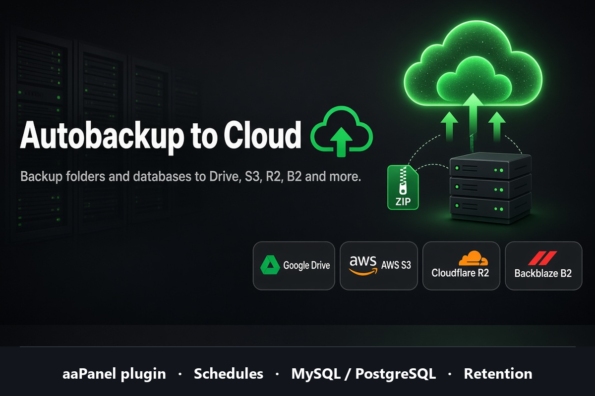

# Autobackup to Cloud

aaPanel third-party plugin that backs up folders and databases to cloud storage on cron schedules.



## Features

- Multiple named backup schedules (create / start / stop / delete / run now)
- Folder backup with `zip -x` exclude patterns
- Optional MySQL and PostgreSQL dumps (`{db}-{time}.sql.gz`)
- Keep N latest backups on storage (per schedule)
- Optional keep local zip after upload
- Backup run logs

## Supported storage

| Provider | Type |
|----------|------|
| Google Drive | OAuth |
| AWS S3 | S3 API |
| Cloudflare R2 | S3-compatible |
| Backblaze B2 | S3-compatible |
| DigitalOcean Spaces | S3-compatible |
| Linode Object Storage | S3-compatible |
| Wasabi / MinIO / other S3-compatible | S3-compatible |

## Requirements

- aaPanel (Linux)
- `zip` on the server
- Panel Python env with `boto3` (S3) and Google API libs (Drive) — installed by `install.sh`

## Install

### Import zip (recommended)

1. Build the package:

```bash
python pack.py
```

2. In aaPanel: **App Store → Third-party → Import plugin**
3. Upload `dist/autobackup_cloud_storage_v*.zip`
4. Open the plugin → **Storage** → choose provider → configure → **Test connection**

### Manual copy

```bash
cp -r autobackup_cloud_storage /www/server/panel/plugin/
bash /www/server/panel/plugin/autobackup_cloud_storage/install.sh install
```

## Quick start

1. **Storage** — pick Google Drive or an S3-compatible provider and save credentials.
2. **Schedules** — create a schedule: source folder, cron preset, optional databases, retention count.
3. **Run** — use **Run** on a schedule, or wait for cron.
4. **Logs** — check per-run status and messages.

### Retention

In the schedule dialog, **Keep on storage (latest backups)**:

- `0` — keep all remote archives (default)
- `N > 0` — after each successful upload, delete older archives of that schedule beyond N newest

Local zip cleanup is controlled separately by **Keep local zip**.

### Reserved POST fields

aaPanel reserves `action`, `s`, `name`, and `a` in plugin POST bodies. Schedule display name is sent as `schedule_name`.

## Project layout

```
autobackup_cloud_storage/
├── info.json
├── index.html
├── install.sh
├── autobackup_cloud_storage_main.py
├── backup_worker.py
├── icon.svg / icon.png
└── acs_lib/          # storage, schedules, dumps, logs
```

Install path on the panel:

```text
/www/server/panel/plugin/autobackup_cloud_storage/
```

## Author

[Tuyen Pham](https://github.com/tuyenlaptrinh)

## License

[MIT](LICENSE.md)
